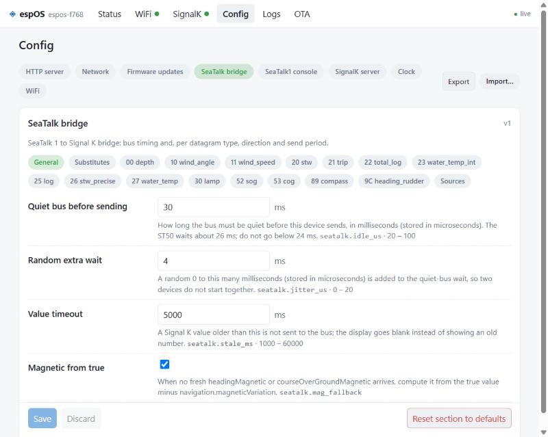

# espos-seatalk-bridge

A Raymarine SeaTalk 1 <-> Signal K bridge for ESP32 and ESP32-S3 boards, built on
[espOS](https://github.com/signalk-espOS/espOS) (ESP-IDF 6).

It bridges SeaTalk 1 datagrams (depth, apparent wind, boat speed, log, water
temperature, SOG, COG, compass heading, rudder angle, lamp level) to and from a
Signal K server over Wi-Fi, with automatic loop prevention, magnetic fallback,
and configurable per-datagram direction and send rates in the device web UI.

## What you need

* **An ESP32 or ESP32-S3 board** (4 MB, 8 MB, or 16 MB flash). Classic ESP32
  needs chip revision 3 or later (e.g., ESP32-WROOM-32E) for signed OTA updates.
* **A SeaTalk 1 electrical interface** (transistor/optocoupler level shifter
  between the 12 V single-wire SeaTalk DATA line and 3.3 V UART RX/TX). See
  [docs/hardware.md](docs/hardware.md) for schematics and TX safety rules.

### Default pins

The settings under **SeaTalk hardware** (`seatalk_hw`) in the device's web UI
start at these pins, and the page shows this build's defaults. Change them only
if your board is wired differently, then restart: a wrong TX pin can hold the
whole bus. Pins reserved by flash or PSRAM, and strapping or USB pins other
than this build's defaults, are refused and logged, leaving the web UI
reachable for recovery.

| Chip | Default RX | Default TX | Default LED enable | Notes |
|---|---|---|---|---|
| **ESP32** | GPIO 32 | GPIO 33 | none (`-1`) | Matches the SeaTalk ESP32 Remote board |
| **ESP32-S3** | GPIO 13 | GPIO 12 | GPIO 11 (active HIGH) | Matches the ESP32-S3 SuperMini wiring; USB-C is USB Serial/JTAG |

> **Bus safety:** On inverted optocoupler/transistor interfaces, driving TX HIGH
> pulls SeaTalk DATA low and jams the bus. Ensure your TX driver has a hardware
> pull-down resistor (e.g., 10 kΩ) so the bus stays released during reset and
> bootloader execution.

## Setup

1. **Flash the firmware.** Use **signalk-espos-manager** (**New board**) or the
   [espOS web flasher](https://signalk-espos.github.io/signalk-espos-manager/flash/)
   from your browser over USB; or download `<name>-<chip>-v<ver>-merged.bin`
   from GitHub Releases and flash at offset `0x0` with `esptool`.
2. **Join Wi-Fi.** On first boot the board opens `espOS-xxxx`. Join it, select
   your boat's Wi-Fi at `http://192.168.4.1`, and reconnect on the boat network.
3. **Approve in Signal K.** Open Signal K **Security → Access Requests** and
   approve the device.
4. **Configure.** Open `http://<device>.local/` to adjust:
   * **SeaTalk hardware** (`seatalk_hw`): RX/TX pins, inversion, RX/TX lights
     enable pin and live switch.
   * **SeaTalk bridge** (`seatalk`): per-datagram mode (`off`, `to_sk`,
     `to_bus`, `both`, `auto`), transmit periods, `$source` filters, idle wait,
     and SOG/COG substitutes.



## Is it working?

Check `http://<device>.local/api/v1/seatalk` from any browser:

```json
{
  "running": true,
  "tx_pin": 12,
  "rx_pin": 13,
  "invert": true,
  "bus_held_low": false,
  "no_echo_pause": false,
  "paused": false,
  "rx_datagrams": 412,
  "rx_bytes": 1840,
  "rx_errors": 0,
  "tx_ok": 95,
  "tx_collisions": 0,
  "tx_dropped": 0,
  "sk_published": 120,
  "sk_received": 95,
  "sk_own_ignored": 0,
  "sk_filtered": 0
}
```

Diagnostics are also published to Signal K under `espos.<hostname>.seatalk.*`
every 10 s.

## Status

Tested on the bench with a Raymarine ST50 Multi display and `signalk-server`:
- PHY self-test and soak runs on a real bus;
- Signal K → SeaTalk: depth, wind, speed, SOG, COG, and heading verified on the
  ST50;
- SOG/COG substitutes (`stw_from_sog`, `hdg_from_cog`);
- Stable heap over time.

SeaTalk → Signal K is implemented and unit-tested, and awaiting extended on-boat
testing with transmitting SeaTalk instruments.

## Reusable component (`components/espos_seatalk`)

The entire SeaTalk 1 stack (`st_phy`, `st_link`, `st_codec`, `st_sched`,
`st_core`, and optional `st_sk`) is packaged as a single ESP-IDF component in
[components/espos_seatalk/](components/espos_seatalk/) with its own
`idf_component.yml`, host unit tests, and standalone `from_registry` example.
See [components/espos_seatalk/README.md](components/espos_seatalk/README.md).

## Build from source

Requires ESP-IDF matching [`.idf-version`](.idf-version) (`v6.1.1`, matching
espOS `v0.32.2`).

### Linux / macOS

```sh
git clone --recursive https://github.com/marcelrv/espos-seatalk-bridge.git
cd espos-seatalk-bridge
. $IDF_PATH/export.sh

# Build esp32 or esp32s3 in separate build directories:
scripts/build.sh -B build-esp32   -DSDKCONFIG=build-esp32/sdkconfig   -DIDF_TARGET=esp32   build
scripts/build.sh -B build-esp32s3 -DSDKCONFIG=build-esp32s3/sdkconfig -DIDF_TARGET=esp32s3 build
idf.py -B build-esp32s3 -p /dev/ttyACM0 flash monitor
```

### Windows (PowerShell)

```powershell
git submodule update --init
. .\tools\idf-env.ps1
idf.py -B build-esp32s3 -DSDKCONFIG=build-esp32s3/sdkconfig -DIDF_TARGET=esp32s3 build
idf.py -B build-esp32s3 -p COMx flash monitor
```

The first local configure generates a development signing key
`secure_boot_signing_key.pem` (git-ignored). Devices only accept OTA images
signed with the key they were flashed with; official GitHub releases are signed
with a persistent CI key (`SIGNING_KEY_PEM`).

## Releases

`release-please` watches `main`, opens a `chore: release <version>` PR, and on
merge tags `vX.Y.Z` and runs espOS's reusable `release-firmware.yml` workflow
to build, sign, attach (`-ota.bin`, `-merged.bin`, `-merged-{4,8,16}mb.bin`),
and mirror images to the `release-assets` branch for the espOS Web Flasher and
`signalk-espos-manager`.

Repository setup required for automated releases:
* **Settings → Actions → General**: enable *"Allow GitHub Actions to create and
  approve pull requests"* with read/write workflow permissions.
* **`SIGNING_KEY_PEM` secret**: persistent RSA-3072 signing key PEM (back up
  offline; losing it prevents future OTA updates to deployed devices).
* Optional: `DOCKERHUB_USERNAME` variable + `DOCKERHUB_TOKEN` secret to avoid
  Docker Hub anonymous pull limits on GitHub runners.

### Bench console (opt-in)

The USB serial bench console (`CONFIG_ST_BRIDGE_BENCH`), unauthenticated LAN
telnet mirror (`CONFIG_ST_BRIDGE_TELNET`), and simulated boat
(`CONFIG_ST_BRIDGE_SIM`) are **off by default** in release builds. To enable
them locally without modifying tracked files, create a git-ignored
`sdkconfig.local` in the project root:

```ini
CONFIG_ST_BRIDGE_BENCH=y
# CONFIG_ST_BRIDGE_TELNET=y
# CONFIG_ST_BRIDGE_SIM=y
```

Delete `build-<target>/sdkconfig` after changing `sdkconfig.local` so IDF
re-applies defaults.

## Host unit tests

```powershell
# Windows (MSVC + Ninja)
powershell -File tools\host-test.ps1 -Clean
```

```sh
# Linux / macOS
cmake -S components/espos_seatalk/test/host -B build-host && cmake --build build-host && ctest --test-dir build-host --output-on-failure
```

## Documentation

- [docs/hardware.md](docs/hardware.md) — SeaTalk interface schematics, signal polarity, TX safety rules
- [docs/protocol.md](docs/protocol.md) — SeaTalk 1 PHY/link/codec/scheduler/Signal K specification

## License

Apache-2.0 ([LICENSE](LICENSE)), the same as espOS. Every source file carries
SPDX headers; [REUSE.toml](REUSE.toml) covers files that cannot.
